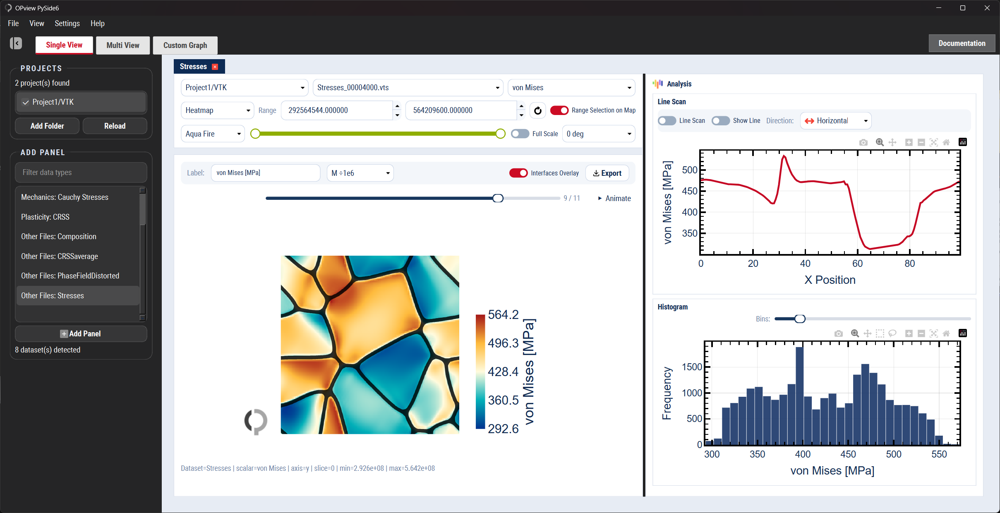
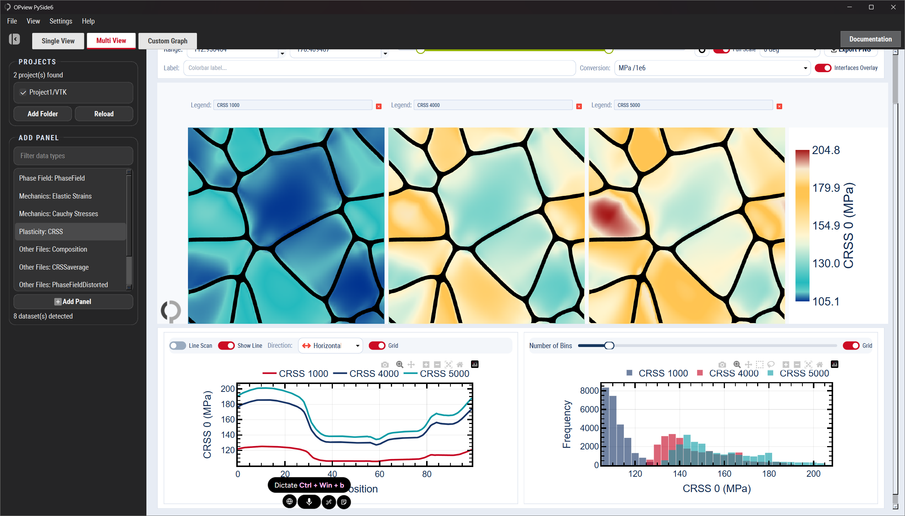
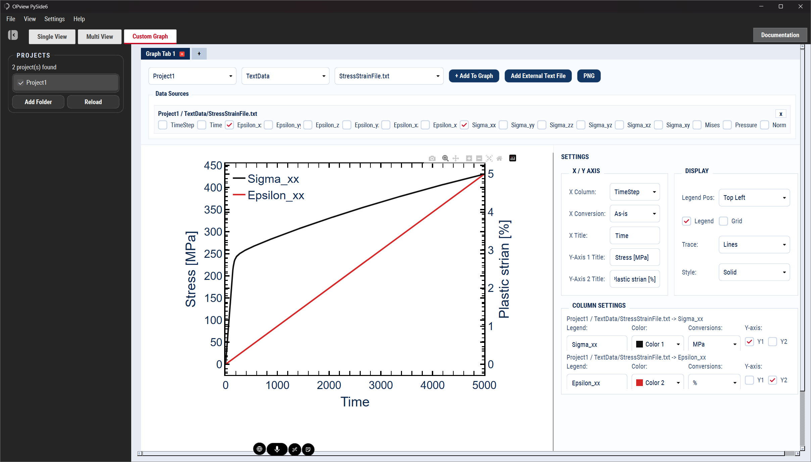

# OPView PySide6

A desktop post-processing application for inspecting OpenPhase simulation output through heatmaps, side-by-side comparison, and custom text-data graphs.

## Features

- Single View heatmaps with range controls, rotation, overlays, line scans, and histogram analysis.
- Multi View comparison across selected VTK files with shared orientation/range controls.
- Multi Property heatmaps for comparing several properties from one VTK file.
- Shared symbol pickers, superscript ion charges, and consistent Greek fonts in colorbars and analysis graphs.
- Custom Graph panels for plotting `TextData` files with per-series colors, conversions, Y-axis routing, markers, and legend placement.
- Local in-app documentation from **Help > Documentation** or the header **Documentation** button.

## Screenshots

### Single View



### Multi View



### Multi Property


### Custom Graph



See the [complete user guide](doc/Documentation.md) and [changelog](CHANGELOG.md) for workflows and release changes.

## Installing a Release Build

For most users this is simpler than the from-source setup below: download a
prebuilt, self-contained package (no Python/pip/venv required) from the
[Releases page](https://github.com/alimuh7x/OPview-pyside6/releases).

- **Windows**: download and run `OPView-<version>-win64.exe`. It installs to
  Program Files and adds a Start Menu "OPView" shortcut. To uninstall, use
  Windows Settings > Apps, or the shortcut in the Start Menu folder.
- **Linux, `.deb` (Ubuntu 22.04+)**:
  ```bash
  sudo apt install ./opview_<version>_amd64.deb
  ```
  then launch from the applications menu or run `opview` in a terminal. On a
  VM or machine without working 3D acceleration, use
  `OPVIEW_NO_GPU=1 opview` instead.
- **Linux, AppImage (x86_64, glibc-based distributions compatible with Ubuntu 22.04 or newer)**:
  ```bash
  chmod +x OPView-<version>-x86_64.AppImage
  ./OPView-<version>-x86_64.AppImage
  ```
  For no-GPU environments: `OPVIEW_NO_GPU=1 ./OPView-<version>-x86_64.AppImage`.

## Setup

The rest of this section covers running OPView from source (for development
or contributing) — skip it if you just installed a release build above.

### Windows

Use the normal GPU/default launcher:

```bat
opview.bat
```

For virtual machines or systems without working 3D acceleration, use the no-GPU software rendering launcher:

```bat
OPview-No-GPU.bat
```

Both launchers check for Python, create the Windows virtual environment `venv-windows` if needed, install dependencies from `requirements.txt`, print setup/debug status messages, and start OPView. The no-GPU launcher also disables GPU-accelerated QtWebEngine rendering before the application starts.

### First-time setup (Linux / macOS / WSL)

```bash
chmod +x opview.sh
./opview.sh
```

### Running the application

On Windows, use the normal launcher:

```bat
opview.bat
```

For no-GPU software rendering, use:

```bat
OPview-No-GPU.bat
```

To scan a specific project folder, or a folder containing projects, pass the path from PowerShell or Command Prompt:

```powershell
.\opview.bat E:\RUB\OpenPhase\MyProject
.\OPview-No-GPU.bat E:\RUB\OpenPhase\MyProject
```

If the path contains spaces, wrap it in quotes:

```powershell
.\opview.bat "E:\RUB\OpenPhase\My Project"
.\OPview-No-GPU.bat "E:\RUB\OpenPhase\My Project"
```

Double-clicking a launcher scans the OPView folder itself. Use PowerShell or a shortcut argument when you want to pass a different project path.

On Linux / macOS / WSL, use:

```bash
./opview.sh
```

To scan a specific project folder, or a folder containing projects, pass the path:

```bash
./opview.sh /path/to/project-or-projects-folder
```

When done, deactivate the virtual environment:
```bash
deactivate
```

## Dependencies

- PySide6 (Qt for Python)
- VTK (Visualization Toolkit)
- NumPy
- Matplotlib
- Plotly
- PyVista
- SciPy
- PyQtGraph

## Usage

1. Start the app with `opview.bat` on Windows, `OPview-No-GPU.bat` for software rendering, or `./opview.sh` on Linux / macOS / WSL.
2. Select or add a project in the sidebar.
3. Choose **Single View**, **Multi View**, **Multi Property**, or **Custom Graph** from the top tabs.
4. Use **Help > Documentation** for the complete local guide.

## Supported File Formats

- `.vti` - VTK Image Data
- `.vts` - VTK Structured Grid
- `.vtu` - VTK Unstructured Grid
- `.vtk` - Legacy VTK format

## Python Version

Use Python **3.12** for the tested development and release build path. Source launchers support Python 3.10–3.13; the Windows launcher currently rejects 3.14. Direct CMake builds also support Python 3.14 with VTK >= 9.6.2. Packaged releases include Python.

## Packaging / Installers

Looking to download a package rather than build one? See
[Installing a Release Build](#installing-a-release-build) above.

See [packaging/README.md](packaging/README.md) for building the Linux `.deb`,
the Linux AppImage, and the Windows NSIS installer via CMake.

## Testing

Run the tests from the repository root with the bundled sample project available:

```bash
QT_QPA_PLATFORM=offscreen QTWEBENGINE_DISABLE_SANDBOX=1 venv/bin/python -m unittest discover tests -v
```

The sandbox override is for headless tests running as root. For normal desktop use, launch OPView without that override.
